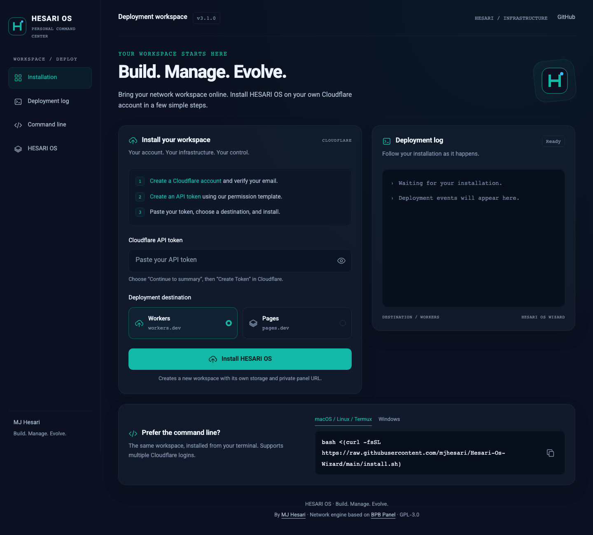

# HESARI OS Wizard

Install [HESARI OS](https://github.com/mjhesari/Hesari-Os) on your own Cloudflare account using a web interface or your terminal. The Wizard creates a Workers or Pages deployment, binds its KV storage, generates credentials and a private panel path, and returns your workspace URL.

The interface uses the HESARI OS navy and teal theme, Vazirmatn typography, H monogram, and workspace navigation.



## Install from your terminal

**macOS, Linux and Android (Termux)**

```bash
bash <(curl -fsSL https://raw.githubusercontent.com/mjhesari/Hesari-Os-Wizard/main/install.sh)
```

**Windows (PowerShell)**

```powershell
irm https://raw.githubusercontent.com/mjhesari/Hesari-Os-Wizard/main/install.ps1 | iex
```

Use Termux from its [official GitHub releases](https://github.com/termux/termux-app/releases). The scripts download the matching binary from this repository, verify its SHA-256 checksum, and download the latest stable HESARI OS `worker.js`. They launch the Wizard from a local `hesari-wizard` directory. Run the script again to install another workspace or use a different Cloudflare account.

Create a Cloudflare API token using the permission-template link printed by the Wizard. The template requests Workers Scripts, Workers KV Storage, Pages and DNS edit access, plus User Details read access. If your token grants access to several accounts, the Wizard uses the first account returned by Cloudflare.

## Run or deploy the web edition

Requires Node.js 24+, npm, and a Cloudflare account. The Go CLI requires the Go version specified in `go.mod`.

```bash
npm ci
cp .dev.vars.example .dev.vars
openssl rand -hex 32
```

Put the generated value in `.dev.vars` as `SECRET`, then run:

```bash
npm run dev
```

For production, authenticate Wrangler and configure a unique secret before deploying:

```bash
npx wrangler login
npx wrangler secret put SECRET
npm run deploy
```

Wrangler prints the actual deployed URL. This repository does not assume a Cloudflare account or a fixed hosted Wizard URL. The Worker serves `web/assets` and handles `/api/deploy`.

The default installation source is:

```text
https://github.com/mjhesari/Hesari-Os/releases/latest/download/worker.js
```

Add `?pre-release=true` to your Wizard URL to use the newest published release with a `worker.js` asset, including prereleases. It uses the HESARI OS releases feed, without assuming a `dev` branch.

The downloaded release must be a complete Panel bundle with runtime profile format 1, as implemented in HESARI OS 5.1.3. Old standalone scripts, incomplete bundles and corrupt compressed sources or assets are rejected before upload. Publish a compatible Panel `worker.js` release before releasing this Wizard.

Every independent installation receives a cryptographically random profile for its KV binding and runtime globals. Both web and CLI deployments use the profile's exact binding name on Workers and Pages, retaining the namespace ID returned by Cloudflare. The profile, account configuration, assets and renamed gzip source are stored together in the deployed worker. Settings saves and Panel updates reuse this profile and the existing KV storage. Keep a private backup of the deployed worker; its configuration contains account credentials. Running Wizard again creates a separate installation, namespace and profile.

## Private installer links and stored credentials

After a web installation, you can copy a private installer link for the same account. The token is encrypted with AES-GCM using the instance's `SECRET`; new links keep the encrypted key in the URL fragment and send it only in the installation POST body. Legacy query-string links are accepted and removed from the visible URL on page load. Changing `SECRET` invalidates existing links.

Anyone with a private installer link can use its Cloudflare token through this Wizard. Keep the link private. The deployed panel contains the account settings and token needed by HESARI OS. The CLI stores login tokens as local JSON with restricted file permissions; it preserves the original `bpb-wizard/store.json` configuration location for existing users. Do not commit `.dev.vars`, login stores, or personalized worker files.

## Development and tests

```bash
npm run check
npm test
npx playwright install chromium
npm run test:ui
go test ./...
go vet ./...
pwsh -NoProfile -File tests/powershell/installer.tests.ps1
npx wrangler deploy --dry-run
```

Tests cover Workers and Pages API flows, fresh accounts, KV bindings, generated panel credentials, invalid tokens, private-link encryption, interrupted streams, desktop/mobile interactions, installer checksum verification, and download failures. Browser tests run against the real local Workers runtime and static-assets binding; Cloudflare account API calls are simulated. The tests do not create live Cloudflare resources.

`npm test` also requires Go and runs the actual uploads from all four web/CLI and Workers/Pages paths in Miniflare against the pinned, credential-free Panel fixture in `tests/fixtures`. It verifies login, VLESS/Trojan subscriptions and restart of the Workers produced by settings save and Panel update against the same persistent local KV database. Provider HTTP calls are mocked. See `tests/fixtures/README.md` to refresh the fixture when the Panel bundle contract changes; keep the vendored contract in `shared/` and its Go counterpart in sync.

`npm run preview` serves only the static interface on `http://127.0.0.1:4173`. Use `npm run dev` for the real web installation endpoint.

Build a CLI archive with:

```bash
make build VERSION="$(cat VERSION)"
```

Release assets use `HESARI-Wizard-<os>-<arch>` names. Build the supported targets by passing `GOOS` and `GOARCH` to `make build`, then generate and publish their checksums:

```bash
npm run release:checksums
gh release create "$(cat VERSION)" dist/HESARI-Wizard-* dist/SHA256SUMS --repo mjhesari/Hesari-Os-Wizard --title "HESARI OS Wizard $(cat VERSION)" --notes-file RELEASE.md
```

A complete test-and-tag-release workflow is provided in `scripts/github-test-and-release.yml`. To enable it, copy that file to `.github/workflows/build.yml` using GitHub credentials with the `workflow` scope. It runs the test suites, builds all platforms, and publishes the archives and checksums when a version tag is pushed. The template is supplied separately because the publishing credential does not have that scope.

For this compatibility fix, first publish the compatible Panel bundle, then update Wizard's `VERSION`, `package.json` and lockfile version together. Run the checks above, build the CLI target archives and generate `SHA256SUMS`. Publish the Wizard release and, separately, deploy the web edition using its existing `SECRET`. These publication steps are manual unless the workflow is enabled; local tests and dry runs do not publish or deploy.

## Credits and license

Maintained by [MJ Hesari](https://mj-hesari.ir). Based on [BPB Wizard](https://github.com/bia-pain-bache/BPB-Wizard) by bia-pain-bache; the network engine is based on [BPB Worker Panel](https://github.com/bia-pain-bache/BPB-Worker-Panel). Licensed under [GPL-3.0](LICENSE).
